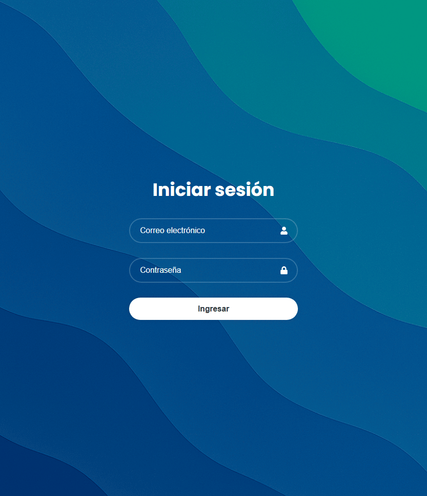
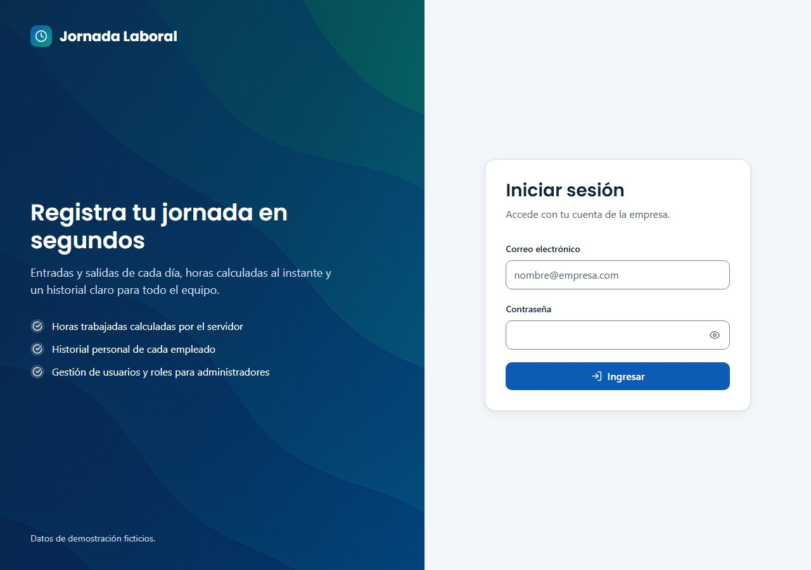
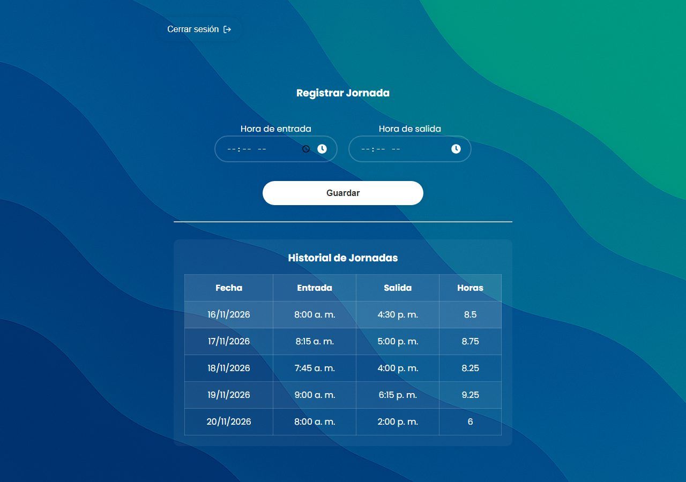
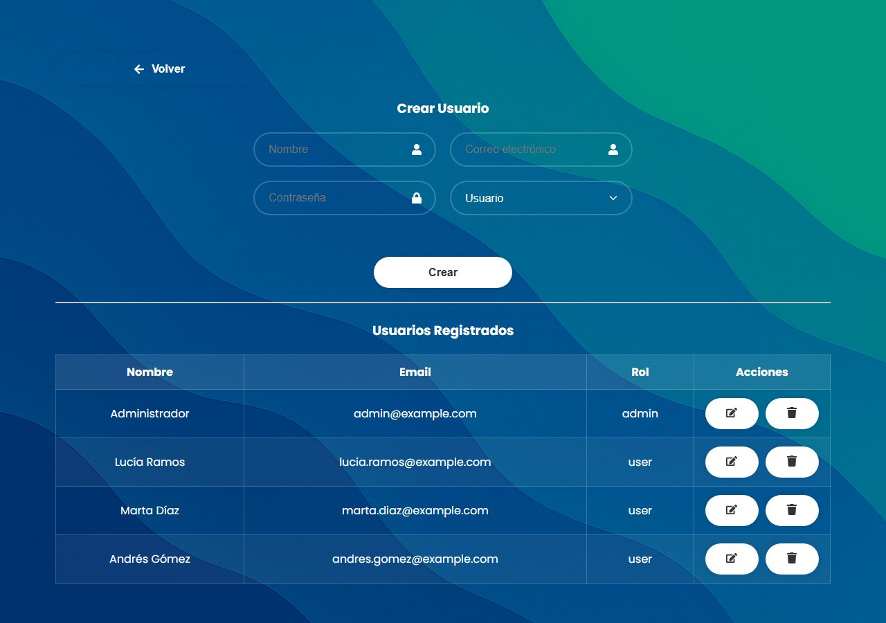
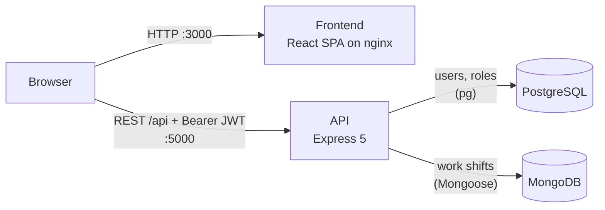

# Jornada Laboral

A containerized work-shift tracker: employees log their daily entry and exit times, and administrators manage user accounts, all behind JWT authentication with role-based access enforced on the server.

[](https://github.com/leonardogr15/JornadaLaboral/actions/workflows/ci.yml)
[](LICENSE)


What it shows technically: an Express 5 API whose authorization is enforced on the server and tested against real PostgreSQL and MongoDB, polyglot persistence, and a React + Vite frontend served behind a strict Content-Security-Policy.



| Sign in | Shift history | User management (admin) |
|---|---|---|
|  |  |  |

*Screenshots and GIF come from the running app with fictional data (see [Regenerating the README media](#regenerating-the-readme-media)).*

The UI is in Spanish (the original target users); code comments, docs and commits are in English.

## Features

- **Login** with email and password; JWT (HS256, 8 h expiry) and automatic logout after 5 minutes of inactivity.
- **Work-shift log**: register entry/exit times; worked hours are calculated on the server; each user only sees their own shifts.
- **User management (admin only)**: list, create, edit and delete users and assign the `user` or `admin` role.
- **Server-side authorization**: the admin role is checked against the database on every request, and the last admin cannot be deleted or demoted.
- **Health endpoint** that checks both databases, used by the Docker healthchecks.
- **One-command setup** with Docker Compose (four services, healthchecks, no database ports exposed).

## Tech stack

| Layer | Technology |
|---|---|
| Frontend | React 19, Vite, React Router 7, Axios; self-hosted fonts; served by unprivileged nginx with a strict CSP |
| API | Node.js 22, Express 5, zod, jsonwebtoken, bcrypt, helmet, express-rate-limit |
| Users | PostgreSQL 16 (`pg`) |
| Work shifts | MongoDB 7 (Mongoose 8) |
| Tests | Jest + Supertest (API, real databases), Vitest + React Testing Library, Playwright (end-to-end), ESLint |
| Delivery | Docker Compose, GitHub Actions, gitleaks |

## Architecture



The frontend is a static bundle; the browser calls the API directly (the API URL is set at build time with `VITE_API_URL`, and the API only accepts browser origins listed in `CORS_ORIGINS`).

**Why two data stores?** The project deliberately demonstrates polyglot persistence:

- **Users** are relational data with a hard uniqueness constraint (email) and a role column used for authorization. PostgreSQL gives constraints, transactions and row locks, which the last-admin protection relies on.
- **Work shifts** are append-mostly, per-user documents read as a time-ordered list. They fit a document store and can grow independently of the user table. The link between both is the numeric user id taken from the verified JWT.

For an application this size a single PostgreSQL database would be enough; the split is a learning and portfolio choice, and it is documented as such.

### Backend layout

```
backend/
  app.js            # createApp(): middleware, routes, error handler (no listen)
  server.js         # startup: config check, DB connections, schema/seed, listen
  config/           # PostgreSQL pool, MongoDB connection, JWT settings
  db/bootstrap.js   # idempotent schema creation + demo admin seed
  middlewares/      # authenticate, requireRole, validate (zod), errorHandler
  validation/       # zod schemas for auth, users and shifts
  models/ controllers/ routes/
  tests/            # Jest + Supertest integration tests
```

## Quick start

Requirements: Docker with Docker Compose v2. Ports 3000 and 5000 must be free.

```bash
git clone https://github.com/leonardogr15/JornadaLaboral.git
cd JornadaLaboral
cp .env.example .env      # then replace every "change-me" value
docker compose up -d --build
docker compose ps         # wait until backend shows "healthy"
```

- App: <http://localhost:3000>
- API: <http://localhost:5000/api> (health: <http://localhost:5000/api/health>)

Stop with `docker compose down` (add `-v` to also delete the database volumes).

Compose refuses to start if a required variable is missing, and the backend refuses to start if `JWT_SECRET` is shorter than 32 characters. See [`.env.example`](.env.example) for every variable.

### Demo login

No default password is published. On startup, if no admin exists, the backend creates one using `DEMO_ADMIN_EMAIL` (default `admin@example.com`) and `DEMO_ADMIN_PASSWORD` (at least 12 characters) from your `.env`. The password is stored only as a bcrypt hash. Log in with those values, then create normal users from **Configuración**.

## Running the tests

Backend integration tests run against real, throwaway PostgreSQL and MongoDB containers (no `.env` needed):

```bash
docker compose -f docker-compose.test.yml run --rm --build backend-test
docker compose -f docker-compose.test.yml down
```

Frontend lint, unit tests and build:

```bash
cd frontend
npm ci
npm run lint     # ESLint, no warnings allowed
npm test         # Vitest
npm run build    # Vite, output in dist/
```

End-to-end checks (Playwright, desktop and mobile) run against the Compose stack. They check the Content-Security-Policy on every route, an admin flow with no CSP violation or console error, and that a normal user cannot reach user management even after editing the token in the browser:

```bash
cd frontend
npx playwright install chromium   # once
E2E_BASE_URL=http://localhost:3000 E2E_API_URL=http://localhost:5000/api   DEMO_ADMIN_PASSWORD=<value from .env> npm run e2e
```

The backend suite covers login (including generic error messages and rate limiting), forged tokens (`alg: none`, wrong key), admin CRUD, **a normal user getting 403 on every user-management action including escalating their own role**, 401 without a token, last-admin protection, shift validation and per-user shift isolation. GitHub Actions runs the backend suite, the frontend lint, tests and build, a Docker Compose build with a health smoke test, and a gitleaks scan of the full history; the end-to-end checks run locally.

Latest published results, from [CI run 45546697793](https://github.com/leonardogr15/JornadaLaboral/actions/runs/45546697793) on `main` (commit `65f4005`, 2026-11-25, before the move to Vite): backend 50 passed, frontend 6 passed, Compose smoke test healthy, gitleaks clean. The badge above shows the current status.

### Regenerating the README media

On a freshly started stack (`docker compose down -v` deletes the local databases, then `docker compose up -d --build`):

```bash
cd frontend
DOCS=1 E2E_BASE_URL=http://localhost:3000 E2E_API_URL=http://localhost:5000/api   DEMO_ADMIN_PASSWORD=<value from .env> npm run e2e
cd .. && sh scripts/make_demo_media.sh   # builds docs/images/demo.gif with a pinned FFmpeg image
```

The spec creates fictional users and shifts through the API and captures real screenshots; the GIF is assembled from them by an FFmpeg container from LinuxServer.io pinned by version and digest, used only on the developer's machine.

## API

Base URL: `http://localhost:5000/api`. Authenticated routes need `Authorization: Bearer <token>`. Errors are JSON `{ "error": "...", "details"?: [...] }`.

| Method | Path | Auth | Description |
|---|---|---|---|
| GET | `/health` | Public | `200` when PostgreSQL and MongoDB respond, `503` otherwise |
| POST | `/auth/login` | Public, rate limited | `{ email, password }` → `{ token }`; `401` with a generic message on failure, `429` after repeated failures |
| GET | `/usuarios/me` | Any user | Read-only profile of the caller |
| GET | `/usuarios` | Admin | List users (no password hashes) |
| GET | `/usuarios/:id` | Admin | Get one user |
| POST | `/usuarios` | Admin | Create `{ nombre, email, password (8–72), rol? }`; `409` if the email exists |
| PUT | `/usuarios/:id` | Admin | Partial update; empty `password` keeps the current one; `409` on duplicate email or when demoting the last admin |
| DELETE | `/usuarios/:id` | Admin | Delete; `409` for the last admin |
| GET | `/jornadas` | Any user | The caller's shifts, oldest first |
| POST | `/jornadas` | Any user | `{ horaEntrada: "HH:MM", horaSalida: "HH:MM", fecha?: "YYYY-MM-DD" }`; exit must be after entry |

Status codes: `400` validation, `401` missing/invalid token or credentials, `403` insufficient role, `404` not found, `409` conflict, `429` too many login attempts, `500` generic (internal details are logged, never returned).

## Security measures

- Authorization on the server: `authenticate` verifies the JWT and reloads the account from PostgreSQL on every request, and `requireRole('admin')` checks that current role. A deleted account loses access to every route immediately, and a demoted admin loses admin routes immediately. A user's own role cannot be changed by themselves.
- Last-admin protection inside a transaction that locks the admin rows.
- JWT algorithm pinned to HS256 for signing and verification; startup fails if `JWT_SECRET` is missing or shorter than 32 characters.
- Passwords hashed with bcrypt; login returns the same message and performs one bcrypt comparison whether or not the email exists (no user enumeration).
- Input validation with zod on every body and id parameter; JSON body limited to 10 kB.
- helmet security headers, rate limit on failed logins, CORS allowlist from `CORS_ORIGINS`.
- Frontend served with a strict Content-Security-Policy: `script-src 'self'`, `style-src 'self'`, `connect-src` limited to the API origin, `frame-ancestors 'none'`, and no `unsafe-inline`, `unsafe-eval` or wildcards. Fonts are self-hosted, so the page loads nothing from third parties.
- `VITE_*` variables are compiled into the public bundle, so only the API URL uses that prefix; secrets stay on the server.
- No credentials in the repository: Compose reads everything from an untracked `.env`; MongoDB requires authentication and the API uses a least-privilege `readWrite` user.
- Containers run as non-root users; databases are not published to the host.
- Secret scanning with gitleaks in CI. A development `.env` committed early in the history was removed; its values are treated as compromised (see [`.gitleaksignore`](.gitleaksignore)).

## Known limitations and roadmap

- The JWT is stored in `localStorage`, which is readable by any script on the page (XSS risk). Planned: httpOnly, `SameSite` cookie with CSRF protection.
- No refresh tokens or server-side revocation list; tokens are valid for 8 hours (account deletion and role changes are still enforced immediately because every request reloads the account).
- Deleting a user keeps that user's shift records in MongoDB (ids are never reused, so they are not exposed to other users).
- The admin UI is only hidden for normal users by decoding the token in the browser; this is cosmetic, the server enforces access.
- Shifts cannot be edited or deleted yet, and overlapping shifts on the same day are not detected.
- The login rate limiter uses in-memory storage, so limits are per instance.
- Domain identifiers (`usuarios`, `jornadas`, `rol`) are Spanish to match the UI and existing data.
- Planned: OpenAPI specification, shift editing, reports per date range, migration tool instead of the startup schema bootstrap.

## License

[MIT](LICENSE) © 2025-2026 Leonardo Galvis
